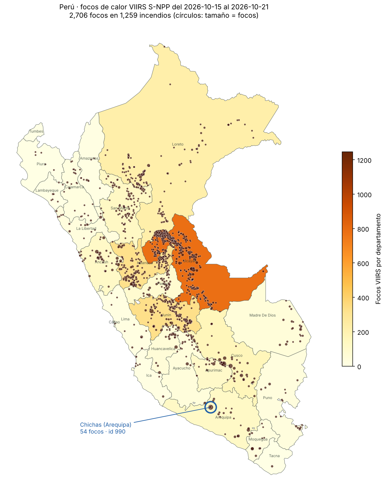
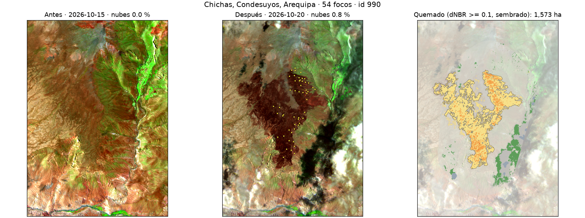
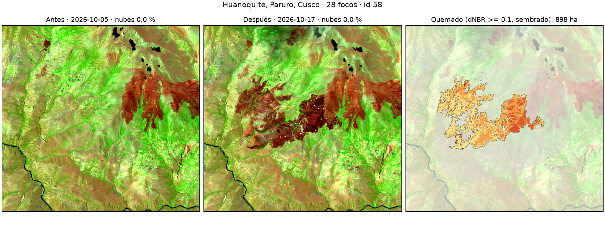
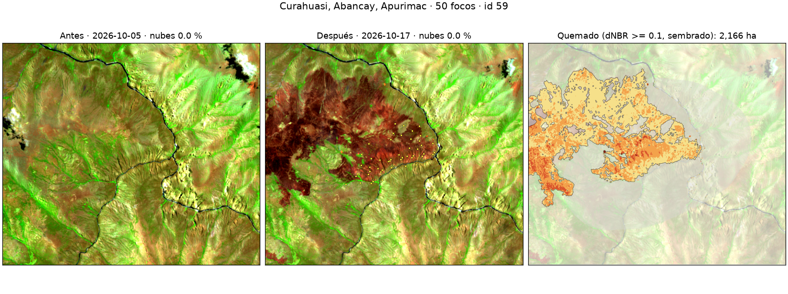
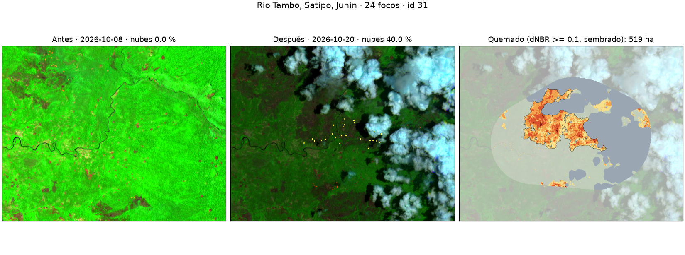
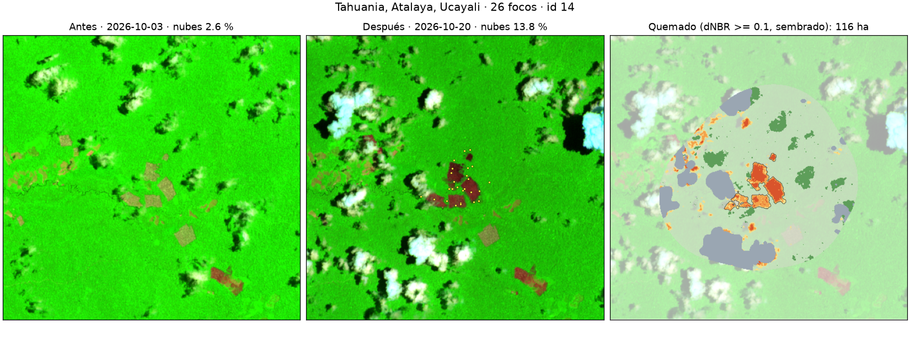
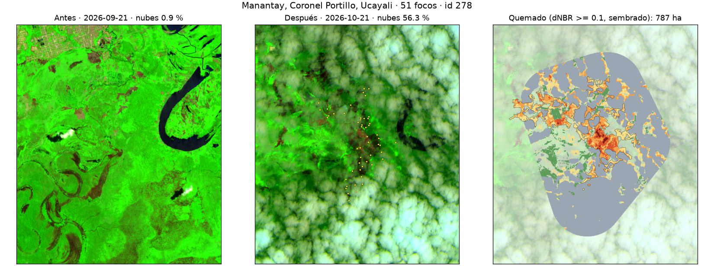
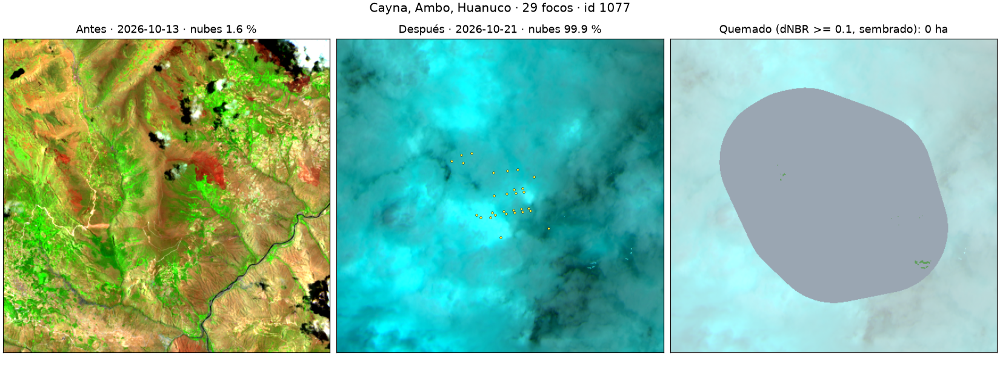

# Incendios en el Perú · ¿Dónde ardió el país y qué se quemó?

**Sesión 14 · Ciencia de Datos con Python · Retos A (área quemada con dNBR) y C (¿qué se quemó?)**

**Dashboard:** [`dashboard/index.html`](dashboard/index.html) (también publicado como web app en Claude; el link está en la entrega). Tiene el mapa nacional, un visor antes/después para cada uno de los 10 incendios y la comparación entre ellos.

## La pregunta

¿Dónde se concentraron los incendios del Perú en la semana del 15 al 21 de octubre de 2026? Y en los **10 incendios con más focos de calor**: ¿cuántas hectáreas se quemaron y qué cobertura se perdió (bosque, pastizal o cultivo)?

## Respuesta corta

- **2 706 focos VIIRS** en 23 departamentos (sin confianza baja ni fuentes fijas), agrupados en **1 259 incendios**. El 61 % de los focos está en Ucayali, Junín, Huánuco y Loreto.
- De los 10 incendios con más focos, **5 se midieron sin nubes: 5 271 ha quemadas**. Manantay se midió en parte (al menos 787 ha, baja confianza) y **4 quedaron tapados por nubes**. Las imágenes antes/después de los 10 están en el dashboard y en `outputs/top10/<id>/`.
- En la **sierra** se quemó sobre todo **pastizal**; en la **selva**, **bosque**.

## Escala nacional



- **Ucayali** concentra 779 focos (29 %). Con Junín (331), Huánuco (323) y Loreto (223) suma el **61 %** del país.
- **29 incendios** tuvieron 10 focos o más.
- Tabla por departamento: [`outputs/focos_por_departamento.csv`](outputs/focos_por_departamento.csv).

## Los 10 incendios con más focos

Mismo método para los 10. Entre paréntesis, el % de nubes **dentro de la zona del incendio** en cada imagen.

| # | Distrito | Departamento | Focos | Imagen antes | Imagen después | ha quemadas (dNBR ≥ 0,10) | ha con 0,27 | Cobertura principal de lo quemado |
|---|---|---|---:|---|---|---:|---:|---|
| 1 | Chichas | Arequipa | 54 | 2026-10-15 (0,0 %) | 2026-10-20 (0,8 %) | **1 573** | 119 | Pastizal 71,7 % |
| 2 | Manantay | Ucayali | 51 | 2026-09-21 (0,9 %) | 2026-10-21 (56,3 %) | ≥ 787 (parcial, 59,4 % sin dato) | 294 | Bosque 50,8 % |
| 3 | Curahuasi | Apurímac | 50 | 2026-10-05 (0,0 %) | 2026-10-17 (0,0 %) | **2 166** | 251 | Pastizal 87,0 % |
| 4 | Cayna | Huánuco | 29 | 2026-10-13 (1,6 %) | 2026-10-21 (99,9 %) | tapado por nubes (99,9 % sin dato) | — | — |
| 5 | Tapo | Junín | 29 | 2026-10-06 (0,2 %) | 2026-10-21 (100,0 %) | tapado por nubes (100,0 % sin dato) | — | — |
| 6 | Huanoquite | Cusco | 28 | 2026-10-05 (0,0 %) | 2026-10-17 (0,0 %) | **898** | 270 | Pastizal 92,3 % |
| 7 | Tahuanía | Ucayali | 26 | 2026-10-03 (2,6 %) | 2026-10-20 (13,8 %) | **116** | 84 | Bosque 97,6 % |
| 8 | Nueva Requena | Ucayali | 26 | 2026-09-21 (0,0 %) | 2026-10-21 (84,1 %) | tapado por nubes (84,1 % sin dato) | — | — |
| 9 | Río Tambo | Junín | 24 | 2026-10-08 (0,0 %) | 2026-10-20 (40,0 %) | **519** | 340 | Bosque 99,7 % |
| 10 | Nueva Requena | Ucayali | 22 | 2026-10-06 (1,6 %) | 2026-10-21 (100,0 %) | tapado por nubes (100,0 % sin dato) | — | — |

Resumen por incendio: [`outputs/top10_resumen.csv`](outputs/top10_resumen.csv). Detalle completo, con severidad, distritos y cobertura: [`outputs/top10.json`](outputs/top10.json). Mapas: `outputs/top10/<id>/mapa.png`.









## Datos y fechas

| Dato | Fuente | Fecha | Resolución |
|---|---|---|---|
| Focos de calor | NASA FIRMS, VIIRS S-NPP NRT, «South America 7d» | 15–21 oct 2026 | 375 m |
| Imágenes antes y después | Sentinel-2 L2A (ESA), catálogo Earth Search (AWS) | 3–20 oct 2026, según el incendio (tabla de arriba) | 20 m |
| Cobertura del suelo | ESA WorldCover v200 | 2021 | 10 m |
| Límites | INEI con UBIGEO, vía [juaneladio/peru-geojson](https://github.com/juaneladio/peru-geojson) | — | vector |

Las imágenes se leyeron de Earth Search porque Planetary Computer devolvió errores 429 (límite de solicitudes). Son los mismos productos L2A. La lista de imágenes candidatas de cada incendio, con fecha y % de nubes, está en `outputs/top10/<id>/candidatas.csv`.

## Método

1. **Focos** (`01_focos.py`). Descargué los focos VIIRS S-NPP de los últimos 7 días y me quedé con los del Perú (cruce con los límites del INEI): 3 088. Quité 362 de confianza baja, que suelen ser reflejos del sol o anomalías débiles. A cada foco le asigné su distrito.
2. **Limpieza de lo que no es incendio.** Los focos FIRMS miden calor, no luz, así que las luces de las ciudades no aparecen; pero sí aparecen volcanes y fuentes industriales. Los datos de 7 días no traen el campo `type` de FIRMS que las marca, así que apliqué tres reglas:
   - **Persistencia:** un punto de ~400 m (un píxel VIIRS) con focos en 4 o más de los 7 días es una fuente fija; un incendio se desplaza.
   - **Volcanes activos** (lista del IGP: Sabancaya, Ubinas, Misti, etc.): fuera los focos a ≤ 5 km.
   - **Fuentes industriales conocidas** (plantas de gas, fundiciones, refinerías): fuera los focos a ≤ 3 km.

   Salieron **20 focos**: 14 de la planta de fraccionamiento de Pisco-Paracas (uno de sus puntos tuvo focos los 7 días), 5 de la fundición de Ilo y 1 de la planta Pampa Melchorita. Ningún foco cayó cerca de un volcán. Quedaron **2 706**. La lista está en [`data/focos_excluidos.csv`](data/focos_excluidos.csv). La limpieza se aplica después de agrupar, así que los `id` de los incendios no cambian; ninguno del top 10 perdió focos.
3. **Incendios.** Agrupé focos a ≤ 1 km y ≤ 48 h en un mismo incendio: 1 259. Ordené por número de focos y tomé los 10 primeros (`04_mapa_nacional.py` hace el mapa y las tablas nacionales).
4. **Imágenes** (`05_top10.py`). Zona de estudio de cada incendio: envolvente de los focos + 2 km. Busqué Sentinel-2 L2A **antes** (hasta 45 días antes del primer foco) y **después** (desde el día siguiente a cuando ya había ocurrido el 90 % de los focos). Medí el % de nubes **dentro de la zona** con la capa SCL y elegí el par del mismo tile con menos nubes, penalizando escenas cortadas por el borde del tile; entre imágenes limpias, la más cercana al incendio. Si la mejor imagen tenía más de 40 % de nubes en la zona, igual guardé las imágenes y medí solo la parte despejada (**parcial**). Si más del 80 % de la zona estaba tapada, no reporto hectáreas (**tapado por nubes**); el dashboard muestra la imagen «antes» con los focos para ubicar el incendio. Busqué también escenas Landsat 8/9 posteriores (`06_buscar_landsat.py`) y no había ninguna.
5. **dNBR.** NBR = (B8A − B12) / (B8A + B12) a 20 m; dNBR = NBR antes − NBR después. Excluí los píxeles con nube, sombra, cirros, agua o nieve en cualquiera de las dos fechas.
6. **Área quemada.** dNBR ≥ 0,10, apertura morfológica para quitar píxeles sueltos, y solo las manchas continuas a ≤ 200 m de un foco VIIRS («dNBR sembrado con focos»). Severidad según las clases del USGS (Key y Benson, 2006).
7. **Cruces.** Superpuse la máscara con los distritos del INEI y con ESA WorldCover 2021 (vecino más cercano a 20 m).

`02_dnbr.py` y `03_cobertura.py` hacen lo mismo para un solo incendio, con más detalle (tabla de sensibilidad al umbral). Los usé primero con Chichas para decidir el método.

### La decisión clave: el umbral

El umbral clásico de 0,27 viene de estudios en bosques. En la puna hay poca biomasa y el dNBR sale bajo aunque la cicatriz se vea clarísima. En Chichas, el 85 % de lo quemado cae entre 0,10 y 0,27:

| Umbral dNBR (Chichas) | Todos los píxeles de la zona | Solo manchas que tocan focos |
|---|---:|---:|
| **≥ 0,10** (elegido) | 1 606 ha | **1 573 ha** |
| ≥ 0,15 | 1 126 ha | 964 ha |
| ≥ 0,20 | 676 ha | 423 ha |
| ≥ 0,27 | 241 ha | 119 ha |

Para los 5 incendios medidos, el total pasa de **5 271 ha** con 0,10 a **1 065 ha** con 0,27.

## Tres hallazgos

1. **En la sierra se quemó pastizal y en la selva, bosque.** En los 3 incendios de sierra (Chichas, Huanoquite, Curahuasi) el **83 %** de lo quemado era pastizal: 3 840 de 4 636 ha. En los 2 de selva (Tahuanía y Río Tambo) el **99 %** era bosque según WorldCover 2021. En Tahuanía se ven parcelas rectangulares: quema de chacras abiertas en el bosque. El impacto económico es distinto: en la sierra, pastos para la ganadería altoandina; en la selva, pérdida de bosque.
2. **La severidad depende del ecosistema.** La proporción de lo quemado con severidad moderada o alta (dNBR ≥ 0,27) fue del **15 %** en Chichas (puna) y del **78 %** en Tahuanía (bosque amazónico). Por eso un solo umbral no sirve para todo el país.
3. **Las nubes esconden la mitad del top 10.** Cayna (Huánuco), Tapo (Junín) y las dos de Nueva Requena (Ucayali) tienen entre 84 % y 100 % de la zona tapada en la mejor imagen posterior (21 de octubre); Manantay, 59 %. Las imágenes antes/después lo muestran. Más focos no significa más hectáreas medibles.

## Limitaciones

- **Un foco de calor no es un incendio.** VIIRS marca píxeles de 375 m con calor anómalo; puede no detectar fuego de baja intensidad o fuego que arde entre dos pasadas del satélite. La agrupación en incendios depende de las reglas de 1 km y 48 h. La limpieza de fuentes fijas usa reglas propias y una lista de plantas conocida: puede quedar alguna fuente industrial pequeña, o salir un incendio real que ardió 4 días en el mismo punto.
- **Las nubes esconden el fuego.** En Manantay el 59 % de la zona quedó sin dato, hay neblina y la imagen «antes» es del 21 de setiembre: sus 787 ha son un mínimo de baja confianza y no entran en el total de 5 271 ha. En Río Tambo el 40 % de la zona quedó sin dato, así que sus 519 ha son un mínimo. Tahuanía tiene 15 % sin dato. Algunas sombras de nube no las marca la capa SCL y dan dNBR negativo (falso «rebrote»).
- **La ventana de focos es de 7 días, pero la de imágenes no.** En Curahuasi la imagen «antes» es del 5 de octubre (elegí una escena completa; la del 13 estaba cortada por el borde del tile), así que sus 2 166 ha incluyen la primera fase del mismo incendio, anterior al 15 de octubre. Además la cicatriz sigue al oeste fuera del recuadro: es un mínimo. En Huanoquite la imagen «antes» ya muestra una cicatriz anterior, que no se cuenta. En ambos, la imagen «después» es del 17 de octubre, anterior a sus últimos focos.
- **El umbral es una decisión** (ver tabla). Con 0,10 entra algo de ruido, que el filtro de focos reduce.
- **WorldCover es de 2021.** «Bosque» en la selva puede ser terreno ya desboscado antes de la quema; en la puna confunde pastizal y matorral.
- **Sin validación.** No comparé con perímetros oficiales (SERFOR, INDECI) ni con datos de campo.

## Cómo reproducirlo

```bash
pip install -r requirements.txt
python 01_focos.py              # focos, limpieza y ranking de incendios (cambia cada día)
python 01_focos.py --reusar     # lo mismo con el CSV ya descargado (reproduce estos resultados)
python 04_mapa_nacional.py      # mapa y tablas nacionales
python 05_top10.py              # antes/después, dNBR y cobertura de los 10 con más focos
# Opcional, un solo incendio con más detalle:
python 02_dnbr.py --id 990 --fuente aws --pre 2026-10-15 --post 2026-10-20
python 03_cobertura.py --fuente aws
```

Los focos FIRMS de 7 días cambian cada día: si corres `01_focos.py` otro día, los incendios y sus `id` serán distintos. Los resultados de este README están guardados en `data/` y `outputs/`.

Código escrito con Claude. Corre en CPU.
