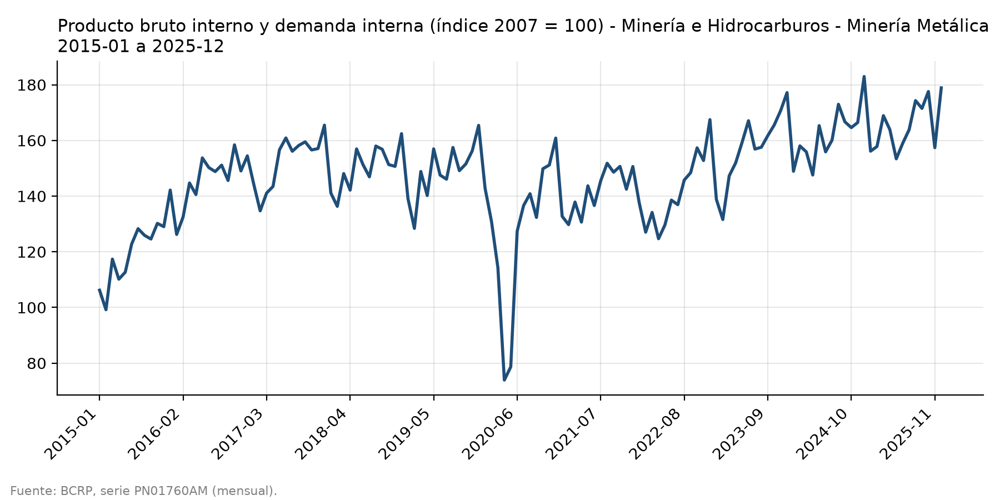
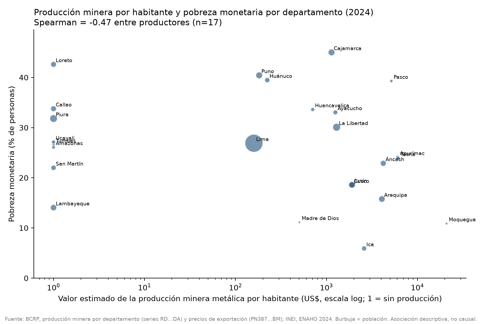
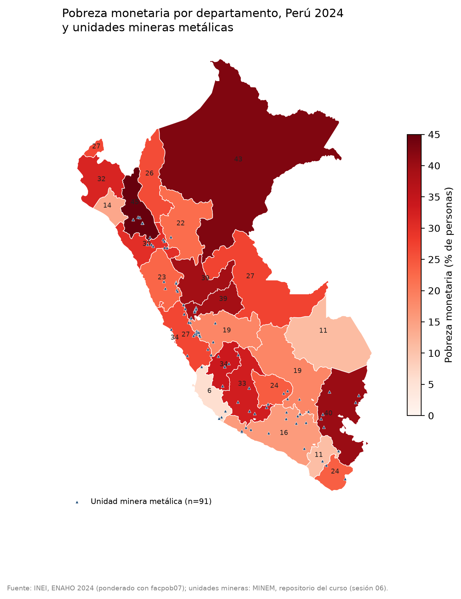
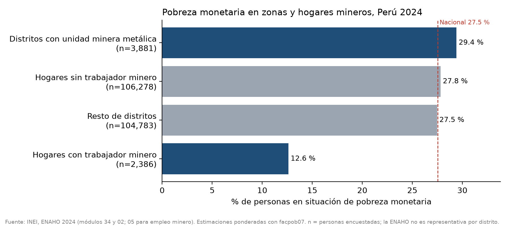

# Minería metálica, canon y pobreza en el Perú (2024)

## 1. Pregunta y delimitación

**Pregunta:** ¿Son más pobres los departamentos y distritos donde se concentra la minería metálica en el Perú, y
cuánto valor produce esa minería frente al canon minero que reciben sus regiones (2024)?

**Delimitación**

- **Año:** 2024. El índice de minería metálica se muestra de 2015-01 a 2025-12 como contexto.
- **Unidades:** 25 departamentos (Lima y Callao por separado). A nivel de distrito solo se distingue entre
  «distritos con al menos una unidad minera metálica» y «resto de distritos». La ENAHO no es representativa por
  distrito.
- **Minería:** metálica (cobre, oro, plata, zinc y plomo). No incluye hidrocarburos ni minería no metálica.
- **Pobreza:** pobreza monetaria del INEI (ENAHO 2024). Las tasas son de personas y van ponderadas con `facpob07`.
- **Alcance:** asociaciones descriptivas. Con 25 departamentos y un corte transversal no se puede afirmar
  causalidad.

## 2. Fuentes y metodología

| Fuente | Qué aporta | Herramienta |
|---|---|---|
| BCRP: producción minera por departamento (series anuales `RD155xxDA`, datos del MINEM) y precios promedio de exportación (`PN38784BM` cobre, `PN38793BM` oro, `PN38796BM` plata, `PN38802BM` zinc, `PN38799BM` plomo) | Cantidad producida y valor estimado por departamento | MCP `bcrp` → `produccion_minera_departamental(anio=2024)` → `salidas/produccion_minera_2024.csv` |
| BCRP `PN01760AM`: PBI de minería metálica (índice 2007 = 100), mensual | Tendencia del sector | MCP `resumen` y `graficar_serie` |
| BCRP `PN37897FM`: ingresos corrientes del gobierno general, canon y regalías (millones S/) | Canon y regalías 2024 (suma de 12 meses) | MCP `resumen` |
| BCRP `PN02229FM`: gasto del gobierno central, transferencias por canon (millones S/) | Canon transferido en 2024 (suma de 12 meses) | MCP `resumen` |
| BCRP `PD04638PD`: tipo de cambio interbancario venta (S/ por US$), diario | Promedio 2024 para pasar US$ a soles | MCP `resumen` |
| INEI, ENAHO 2024 (código 966), módulos 34, 02 y 05 | Pobreza monetaria, área, departamento, hogares con trabajador minero | Skills `limpiando-enaho`, `graficando-enaho`, `mapeando-enaho` y `cruzando-mineria` |
| `datos/unidades_mineras.csv` | Distritos con unidad minera metálica | Skills `limpiando-enaho` y `mapeando-enaho` |

**Pasos**

1. **Validación de la ENAHO.** `salidas/validacion.txt` dice **APROBADO** (11 de 11 pruebas esenciales). La
   pobreza nacional ponderada es 27.53 %, frente al 27.6 % que publica el INEI. Se conservan 108,664 residentes
   habituales y la población expandida es 34,147,768.
2. **Valor de la producción.** El MCP calcula, por departamento y metal, cantidad × precio promedio anual de
   exportación del BCRP. Es una **valorización aproximada**, no el valor bruto de producción oficial. Frente al
   total nacional de cada metal, la suma de departamentos cubre 100 % del cobre, zinc y plomo, 99.58 % del oro y
   98.78 % de la plata.
3. **Cruce.** `cruzando-mineria` une la producción (por código `ccdd`) con la pobreza departamental ponderada.
   Luego calcula la producción por habitante, correlaciones de Pearson y Spearman, y compara, dentro de cada
   departamento, los distritos con unidad minera frente al resto. Se le pasó `--tc 3.755301`, el promedio 2024
   de `PD04638PD`.
4. **Mapa.** `mapeando-enaho` une `ubigeo[:2]` con `FIRST_IDDP` y exige que los 25 departamentos tengan dato.
5. **Total nacional valorizado y cociente canon / valor.** Se sumó la columna `valor_musd` de
   `salidas/produccion_minera_2024.csv` con un script (sección 7), no a mano.

## 3. Hallazgos

### Hallazgo 1. La minería metálica creció hasta un récord en 2024

Según `PN01760AM`, el índice de minería metálica pasó de 106.19 (2015-01) a 178.88 (2025-12). Es una variación de
**+68.46 %**. El mínimo fue 73.90, en 2020-04 (pandemia), y el máximo, **182.95, en 2024-12**.
(Fuente: <https://estadisticas.bcrp.gob.pe/estadisticas/series/api/PN01760AM/json/2015-1/2025-12>)



### Hallazgo 2. Los departamentos más mineros no son, en conjunto, los más pobres, pero hay excepciones claras

- 17 de los 25 departamentos tienen producción minera metálica registrada por el BCRP en 2024. Su pobreza promedio,
  ponderada por población, es **27.23 %**. La de los 8 departamentos no productores es **28.56 %**
  (`salidas/cruce_mineria_2024.csv`).
- Entre los productores, la correlación entre pobreza y valor de producción por habitante es negativa: Spearman
  **−0.468** y Pearson **−0.393**. La figura indica n = 17. Es una asociación débil a moderada y solo descriptiva.
- Los mayores productores por valor estimado son Arequipa (**5,754.2 millones de US$**, pobreza 15.8 %), Áncash
  (5,054.1; 22.9 %) y Moquegua (4,111.5; 10.9 %). Moquegua tiene el mayor valor por habitante
  (**20,892.9 US$**) y una de las pobrezas más bajas del país (10.88 %).
- **Excepciones:** Cajamarca es el departamento más pobre del país (**44.99 %**) y produce 1,760.5 millones de
  US$, sobre todo oro. Pasco tiene una pobreza de 39.28 % con 1,669.4 millones de US$. Apurímac, con 2,877.1
  millones de US$ y 6,064.1 US$ por habitante, tiene una pobreza de 24.1 %.
- La pobreza más alta, después de Cajamarca, está en Loreto (42.61 %) y Puno (40.42 %). La más baja está en
  Ica (5.91 %) y Moquegua (10.88 %) (`figuras/pobreza_departamento.png`, `mapas/pobreza_departamento.png`).





### Hallazgo 3. En los distritos con minas la pobreza es algo mayor, pero en los hogares con trabajadores mineros es menos de la mitad

Datos de `salidas/pobreza_zonas_mineras_2024.csv` y `figuras/pobreza_mineria.png` (INEI, ENAHO 2024):

| Grupo | Pobreza (% de personas) | n en muestra |
|---|---|---|
| Distritos con unidad minera metálica | **29.40** | 3,881 |
| Resto de distritos | 27.48 | 104,783 |
| Hogares con trabajador minero | **12.61** | 2,386 |
| Hogares sin trabajador minero | 27.82 | 106,278 |

Comparados dentro de su propio departamento, los distritos mineros muestran resultados muy distintos
(`cruzando-mineria`, grupos con 30 personas o más en la muestra):

- **Menos pobres que el resto:** Cajamarca (−11.5 pp), Áncash (−10.9 pp) y Lima (−7.5 pp).
- **Más pobres que el resto:** Arequipa (+18.7 pp), Moquegua (+16.0 pp), Cusco (+15.9 pp) y Huánuco (+14.9 pp).
  Huánuco tiene solo 54 personas en distritos mineros y Junín 47, así que esas diferencias son muy inciertas.



### Hallazgo 4. El canon y las regalías equivalen a cerca del 5 % del valor estimado de la producción

- **Valor estimado de la producción minera metálica en 2024:** **37,464.3 millones de US$**, de los cuales 23,171.6
  son cobre y 8,060.7 oro (suma de `salidas/produccion_minera_2024.csv`). Al tipo de cambio promedio de
  **3.755301 S/ por US$** (`PD04638PD`, 2024) son **140,689.7 millones de S/**.
- **Ingresos del gobierno general por canon y regalías en 2024 (`PN37897FM`, suma):** **6,743.3 millones de S/**.
  Es el **4.79 %** del valor estimado.
  (<https://estadisticas.bcrp.gob.pe/estadisticas/series/api/PN37897FM/json/2024-1/2024-12>)
- **Transferencias por canon del gobierno central en 2024 (`PN02229FM`, suma):** **7,385.3 millones de S/**. Es
  el **5.25 %** del valor estimado. Las transferencias se concentran en julio (máximo de 3,021.8 millones de S/).
  (<https://estadisticas.bcrp.gob.pe/estadisticas/series/api/PN02229FM/json/2024-1/2024-12>)
- **No fue posible comparar región por región** el valor producido con el canon recibido, porque no existe
  `datos/canon_minero_2024.csv` (sección 6).

## 4. Interpretación

- **Nivel departamental.** Los datos no muestran que los departamentos mineros sean, en promedio, más pobres. La
  diferencia entre productores (27.23 %) y no productores (28.56 %) es pequeña, y entre productores la relación
  entre valor por habitante y pobreza es negativa. Aun así, la dispersión es grande: Cajamarca y Pasco combinan
  mucha producción con mucha pobreza, y Moquegua e Ica combinan producción con poca pobreza. La relación
  depende de otros factores (urbanización, agricultura de exportación, conectividad, tipo de mineral) que este
  análisis no controla.
- **Nivel local.** Los distritos con unidad minera tienen una pobreza ligeramente mayor que el resto (29.40 % frente
  a 27.48 %). En cambio, los hogares con un trabajador minero son mucho menos pobres (12.61 %). Esto sugiere que
  el beneficio monetario directo llega sobre todo a quienes tienen empleo en el sector, no al conjunto del
  distrito. Es una lectura descriptiva: el empleo minero también selecciona personas con más educación o
  calificación.
- **Valor frente a canon.** Por cada 100 soles de valor estimado de producción metálica, el Estado registró unos
  4.8 soles de canon y regalías como ingreso, y transfirió unos 5.3 soles de canon. Dos advertencias: el canon
  de un año se calcula sobre el impuesto a la renta del ejercicio anterior, y estas series agregan todos los
  tipos de canon, no solo el minero.
- **Causalidad.** Nada de lo anterior permite decir que la minería causa ni que reduce la pobreza.

## 5. Limitaciones

1. **La ENAHO no encuesta viviendas colectivas**, como los campamentos mineros. Parte de los trabajadores mineros,
   en especial los que trabajan por turnos, no aparecen en la muestra.
2. **La ENAHO no es representativa por distrito.** Las cifras de «distritos con unidad minera» juntan 48 de los
   69 distritos con unidad metálica (los que tienen hogares encuestados). Varias comparaciones dentro de un
   departamento descansan en menos de 150 personas (por ejemplo Junín con 47 y Huánuco con 54).
3. **El valor de la producción es aproximado.** Es cantidad × precio promedio de exportación del BCRP, no el valor
   bruto de producción oficial. Solo cubre cobre, oro, plata, zinc y plomo, y la cobertura de oro y plata no es
   completa (99.58 % y 98.78 %). El precio de exportación incluye el valor de concentración o refinación.
4. **No hay canon minero por departamento.** `datos/canon_minero_2024.csv` (exportado del MEF) no está en el
   proyecto. El cruce se hizo sin canon departamental y el cociente canon / valor solo existe a nivel nacional.
5. **Las series de canon no son exclusivamente mineras.** `PN37897FM` («Canon y regalías») y `PN02229FM`
   («Transferencias – Canon») agregan canon minero, gasífero, petrolero, hidroenergético, forestal y pesquero,
   y en el primer caso también regalías. Además hay un desfase temporal: el canon de 2024 se calcula sobre la
   renta de 2023.
6. **Correlaciones con pocos datos.** 17 productores y un solo año. Son correlaciones ecológicas: no dicen nada
   sobre las personas.
7. **Pequeñas diferencias con la referencia del curso.** El mapa difiere de la referencia de la Sesión 16 en hasta
   0.52 pp (Puno). Hay 14 departamentos con más de 0.1 pp de diferencia, que se deben al redondeo y a la
   construcción de la base. La pobreza nacional sí coincide con el INEI (27.53 % frente a 27.6 %).
8. **Detalle técnico del MCP.** En el listado por departamento, Apurímac aparece dos veces («Apurimac» y
   «Apurímac»), porque la serie de plata trae otro nombre. `cruzando-mineria` agrupa por código `ccdd`, así que
   el total del departamento queda bien (2,877.1 millones de US$).

## 6. Reproducibilidad

**Series del BCRP (MCP `bcrp`)**

| Llamada | Periodo | Resultado usado |
|---|---|---|
| `produccion_minera_departamental(anio=2024)` | 2024 | `salidas/produccion_minera_2024.csv` |
| `resumen("PN01760AM", "2015-01", "2025-12")` | 2015-01 a 2025-12 | variación +68.4558 %; máx. 182.95 (2024-12) |
| `resumen("PN37897FM", "2024-01", "2024-12")` | 2024 | suma 6,743.313259 millones de S/ |
| `resumen("PN02229FM", "2024-01", "2024-12")` | 2024 | suma 7,385.327381 millones de S/ |
| `resumen("PD04638PD", "2024-01-01", "2024-12-31")` | 2024 | promedio 3.755301 S/ por US$ (246 datos) |
| `graficar_serie("PN01760AM", "2015-01", "2025-12")` | 2015-01 a 2025-12 | `figuras/bcrp_PN01760AM.png` |

**Comandos de las Skills** (desde `tarea_4/`)

```bash
# limpiando-enaho ya había corrido: salidas/personas_2024.parquet y salidas/validacion.txt (APROBADO)
uv run .claude/skills/graficando-enaho/scripts/graficar.py --tipo todos
uv run .claude/skills/mapeando-enaho/scripts/mapear.py
uv run .claude/skills/cruzando-mineria/scripts/cruzar.py --anio 2024 --tc 3.755301
```

**Total nacional valorizado y cocientes del hallazgo 4**

```bash
uv run python -c "
import pandas as pd
p = pd.read_csv('salidas/produccion_minera_2024.csv', dtype={'ccdd': str})
tot = p.valor_musd.sum(); tc = 3.755301
print(round(tot, 1), round(tot*tc, 1))                       # 37464.3 MUS$, 140689.7 mill. S/
print(round(100*6743.313259/(tot*tc), 2), round(100*7385.327381/(tot*tc), 2))  # 4.79 %, 5.25 %
print(p.groupby('metal').valor_musd.sum().round(1))"
```

**Archivos generados:** `salidas/produccion_minera_2024.csv`, `salidas/cruce_mineria_2024.csv`,
`salidas/pobreza_zonas_mineras_2024.csv`, `salidas/pobreza_departamento_mapa.csv`, `figuras/bcrp_PN01760AM.png`,
`figuras/pobreza_area.png`, `figuras/pobreza_sexo.png`, `figuras/pobreza_departamento.png`,
`figuras/pobreza_mineria.png`, `figuras/mineria_vs_pobreza.png` y `mapas/pobreza_departamento.png`.
