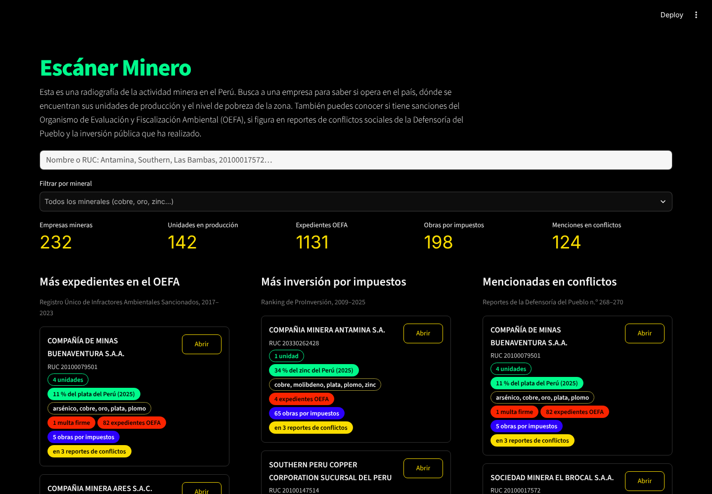
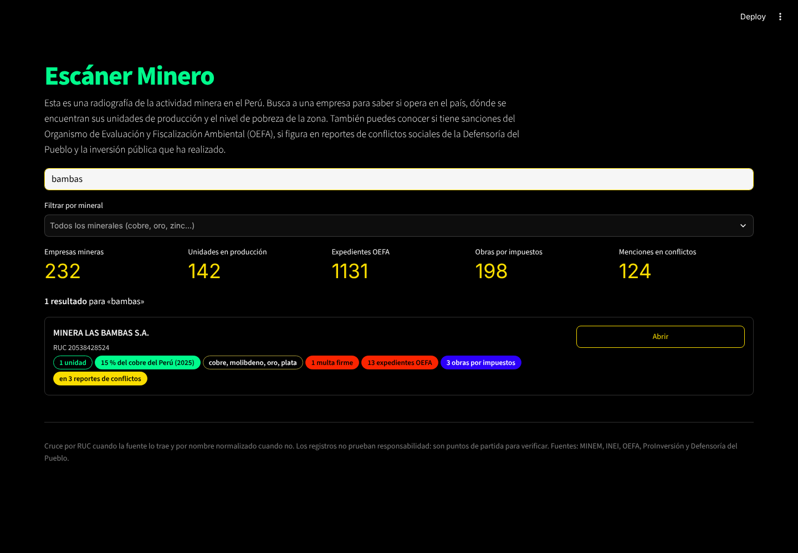
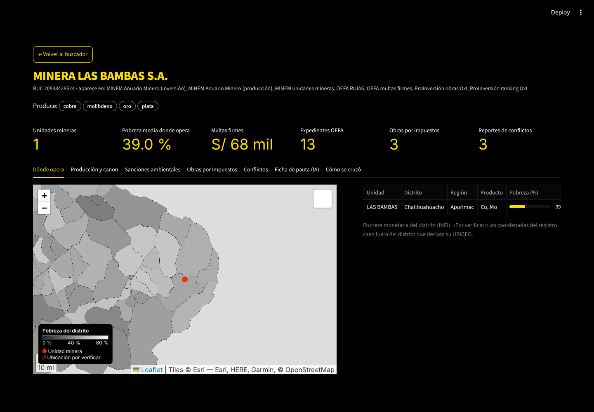
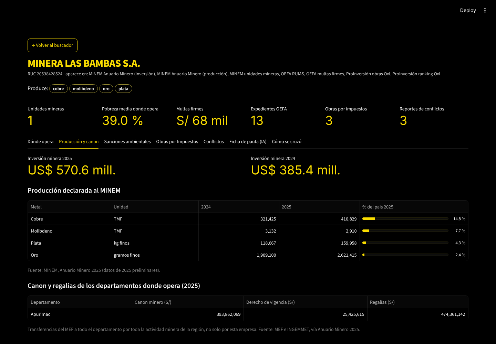
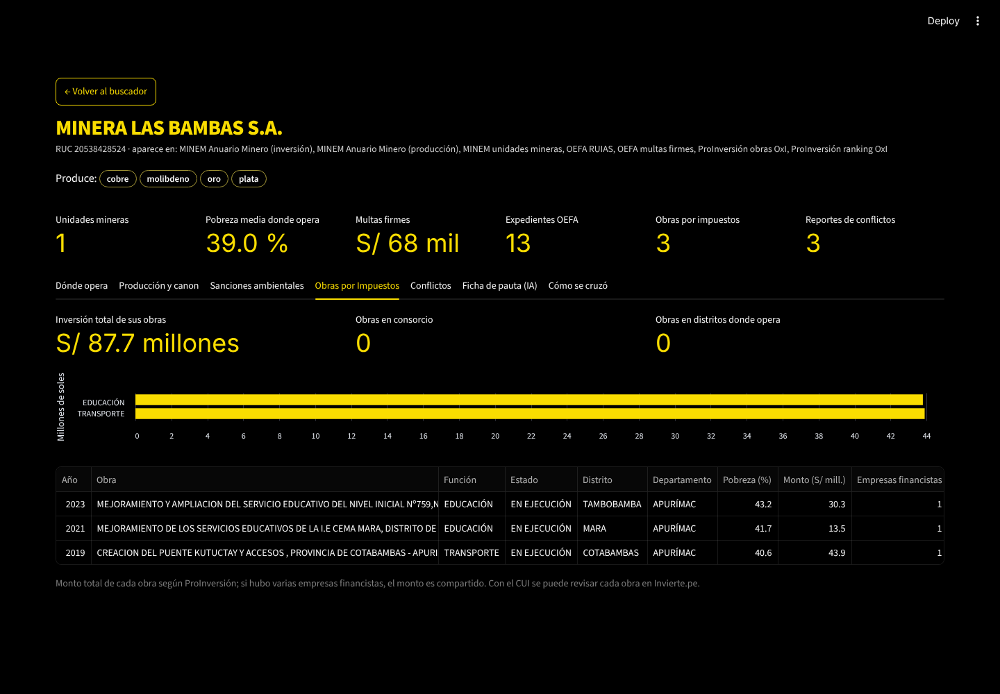
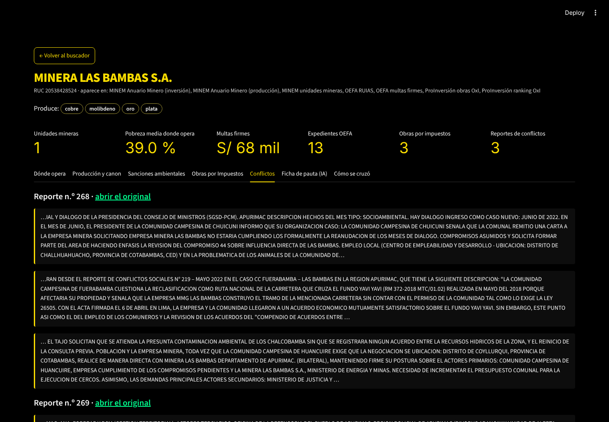
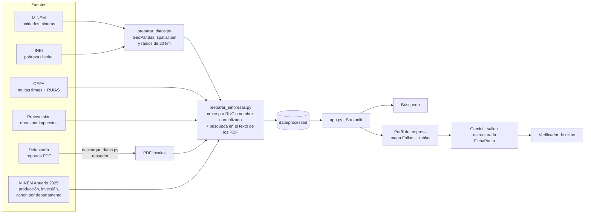

# Escáner Minero · Gallo Negro

**Una radiografía de la actividad minera en el Perú: escribe el nombre de una empresa y
mira en una sola ficha qué produce y cuánto pesa en la producción nacional, dónde
opera, cómo viven esos distritos, el canon que reciben esas regiones, cómo la sancionó
el OEFA, qué obras financió por Obras por Impuestos y en qué conflictos sociales aparece.**

> Demo: **[https://escaner-minero-peru.streamlit.app/](https://escaner-minero-peru.streamlit.app/)**
> Video de respaldo: `PENDIENTE: enlace al video de 60 a 90 segundos`



---

## 1. Fundadora

**Valeria Vicente**, periodista y reportera de campo, cofundadora de Gallo Negro, un
medio de periodismo narrativo audiovisual sobre las consecuencias del extractivismo en
América Latina. El Escáner Minero nace de la primera fase de su flujo de producción:
investigar a una empresa antes de salir a campo.

## 2. Problema

Para saber quién es una empresa minera hoy hay que abrir seis portales que no se
hablan entre sí: el MINEM para sus unidades y su producción, el INEI para la pobreza de
esos distritos, el MEF para el canon, el OEFA para sus sanciones, ProInversión para sus
obras por impuestos y la Defensoría del Pueblo para los conflictos, este último en PDF
de cien páginas. Ninguno usa el mismo
identificador: el mismo titular aparece como «CIA MINERA PODEROSA S A» en una fuente y
«COMPAÑÍA MINERA PODEROSA S.A.» en otra.

Un medio pequeño no tiene un equipo de datos para cruzar eso. El resultado: días de
investigación previa o reportajes sin contexto.

**Evidencia de usuarias:** notas de 3 conversaciones en [`docs/research/`](docs/research/).
`PENDIENTE: resumir aquí en 3 líneas lo que dijeron.`

## 3. Solución e insight

Inspirado en [Suprema Fortuna](https://supremafortuna.ojo-publico.com/) de Ojo Público y
en [Manolo](https://github.com/manolo-rocks), el escáner hace tres cosas:

1. **Busca** por nombre o RUC entre 232 empresas mineras, y filtra por mineral.
2. **Reúne** en una ficha por empresa, con enlace propio para compartir: minerales que
   produce y su participación en la producción nacional 2025, inversión minera, unidades
   en el mapa con la pobreza de su distrito, canon y regalías de los departamentos donde
   opera, multas firmes y expedientes del OEFA, obras por impuestos (marcando las que
   caen donde opera) y fragmentos de los reportes de conflictos con enlace al original.
3. **Propone una pauta**: Gemini lee solo los registros de esa empresa y devuelve una
   ficha estructurada (titular, pregunta, datos con fuente, actores, preguntas de
   entrevista, lo que falta verificar). Un verificador revisa que cada cifra exista en
   los registros.

**Insight:** el valor está en el cruce, no en cada base. Y un cruce sin identificador
común solo es confiable si es transparente: cada perfil muestra con qué nombre aparece la
empresa en cada fuente y si se unió por RUC o por nombre.

| Búsqueda | Perfil | Producción y canon | Obras por Impuestos | Conflictos |
|---|---|---|---|---|
|  |  |  |  |  |

## 4. ¿Por qué ahora?

- El OEFA publica desde 2024 su Registro Único de Infractores Ambientales Sancionados
  como datos abiertos, con RUC: por primera vez hay una llave para cruzar.
- Los modelos con **salida estructurada** convierten registros en una ficha con formato
  fijo y verificable, a un costo aproximado de US$0.003 por ficha con `gemini-2.5-flash`,
  que tiene capa gratuita.
- En el Perú, proyectos periodísticos como La Encerrona o El Diario de Curwen ya se
  sostienen en YouTube con suscripciones. Son equipos chicos, sin un área de datos.

## 5. Demo

**URL:** [https://escaner-minero-peru.streamlit.app/](https://escaner-minero-peru.streamlit.app/)

### Correr en local

```bash
cd trabajo_final
python -m venv .venv && source .venv/bin/activate
pip install -r requirements.txt
cp .streamlit/secrets.toml.example .streamlit/secrets.toml   # pega tu clave de Gemini (opcional)
streamlit run app.py
```

Sin clave, la ficha de pauta se arma con reglas fijas (plan B para la presentación).

### Actualizar los datos

```bash
python3 scripts/descargar_datos.py --reportes 3   # RUIAS del OEFA + reportes de la Defensoría
python scripts/preparar_datos.py                  # unidades, distritos y radios de 20 km
python scripts/preparar_empresas.py               # cruce de todas las fuentes por empresa
python -m pytest -q
```

`descargar_datos.py` es el raspador: recorre el listado paginado de la Defensoría y baja
los reportes (PDF o HTML). Debe correrse desde una computadora con salida normal a
internet. Las multas firmes del OEFA y las listas de ProInversión se descargan a mano
desde sus portales (ver [`data/README.md`](data/README.md)).

### Arquitectura



### Modelos y APIs

| Qué | Para qué |
|---|---|
| `gemini-2.5-flash` (Google Gemini API, SDK `google-genai`) | Ficha de pauta con el esquema `FichaPauta` (Pydantic) |
| GeoPandas + Folium | Validar coordenadas de las unidades, radios de influencia y mapa |
| pdfplumber | Extraer el texto de los reportes de la Defensoría |

## 6. Modelo de negocio

*Hipótesis a validar con las conversaciones de `docs/research/`.*

- **Quién paga:** medios independientes y regionales, ONG de defensa del territorio,
  equipos de investigación universitaria y, en un segundo momento, áreas de
  cumplimiento o riesgo que hoy compran informes de *due diligence*.
- **Precio:** búsqueda y perfiles gratis. Plan Redacción a S/ 49 al mes con fichas de
  pauta ilimitadas, exportación y alertas cuando una empresa recibe una nueva sanción o
  aparece en un nuevo reporte. Plan institucional a S/ 290 al mes con descargas de datos
  y capas propias.
- **Costo por usuario:** con 100 fichas al mes, cerca de US$0.30 en Gemini. El hosting
  entra en la capa gratuita de Streamlit Community Cloud mientras el uso sea bajo.

## 7. Herramientas del curso en el producto

| Herramienta | Sesión | Dónde vive | Por qué |
|---|---|---|---|
| Análisis geoespacial con GeoPandas y Folium | 06 | [`scripts/preparar_datos.py`](scripts/preparar_datos.py), [`radar/mapa.py`](radar/mapa.py) | El spatial join detecta 34 unidades cuyas coordenadas caen fuera de su distrito declarado; el mapa ubica cada unidad sobre la pobreza distrital |
| LLM con salidas estructuradas | 08 | [`radar/pauta.py`](radar/pauta.py) | El esquema obliga a separar datos con fuente, lo que falta verificar y los riesgos; el verificador comprueba cada cifra |
| Web scraping (apoyo) | — | [`scripts/descargar_datos.py`](scripts/descargar_datos.py) | Baja los reportes de la Defensoría como hace Manolo con los registros de visitas |
| Dashboard en Streamlit (apoyo) | 05 | [`app.py`](app.py) | La interfaz de búsqueda y los perfiles |

## 8. Lo que generó el agente

El código se construyó con un agente (Claude). El agente generó el raspador, los
scripts de cruce, la normalización de nombres, la app, el prompt y el esquema de la
ficha, el verificador, las pruebas y este README en borrador.

Las decisiones de producto fueron mías: el problema y el público, las fuentes que debía
cruzar (incluidas Obras por Impuestos y la Defensoría), las referencias de Ojo Público y
Manolo, y el criterio de mostrar el método del cruce y no inventar cifras.
`PENDIENTE: agregar qué corregiste o cambiaste tú.`

## 9. Limitaciones

- **Cruce por nombre:** la lista de unidades del MINEM no trae RUC. Las coincidencias
  se muestran en la pestaña «Cómo se cruzó» de cada perfil.
- **Cobertura:** las multas firmes cubren 2024–2025; el RUIAS, 2017–2023; las obras por
  impuestos llegan hasta 2025; los conflictos, solo a los reportes n.º 268–270.
- **Montos del OEFA:** el RUIAS registra multas en UIT que no siempre coinciden con las
  multas firmes del mismo expediente; por eso no se suman.
- **Conflictos:** el texto del PDF sale desordenado por el diseño a dos columnas. Los
  fragmentos son pistas y cada uno enlaza al reporte original.
- **Obras por Impuestos:** el monto es el total de cada obra, aunque se haya financiado
  en consorcio.
- **Producción y canon:** la producción 2025 del Anuario Minero es preliminar y cubre
  ocho metales. El canon y las regalías son del departamento entero, por toda su
  actividad minera, no de una sola empresa.
- Ningún registro prueba responsabilidad: el escáner muestra cruces para verificar.

## Licencia

MIT. Ver [`LICENSE`](LICENSE).
